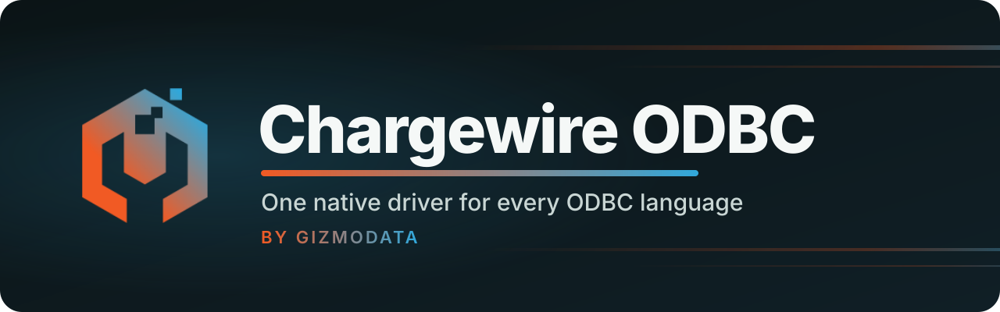

<p align="center"></p>
<p align="center">
<a href="https://github.com/gizmodata/chargewire-odbc/actions/workflows/ci.yml"></a>
<a href="https://github.com/gizmodata/chargewire-odbc/releases/latest"></a>
<a href="LICENSE"></a>
</p>

The generic **Chargewire ODBC driver** connects ODBC applications to any compatible
[Chargewire](https://github.com/gizmodata/chargewire) server over HTTP/HTTPS, using the
native C++ client and Apache Arrow IPC. It has no Flight SQL, gRPC or protobuf transport.

It retains the [GizmoSQL ODBC driver's](https://github.com/gizmodata/gizmosql-odbc-driver)
ODBC compatibility layer and regression suites. Product drivers build this code and
supply only their branding, URI translation and session initialization hooks.
[Hardcharger ODBC](https://github.com/gizmodata/hardcharger-odbc-driver) is one such wrapper.

## Install

On macOS 15+ (Apple Silicon), install and register the driver with
`brew install gizmodata/tap/chargewire-odbc`.

Or download a package from [Releases](https://github.com/gizmodata/chargewire-odbc/releases/latest).

| Platform | Package |
|---|---|
| Windows x64 | `Chargewire-ODBC-Driver-x64.msi`, signed DLL and ZIP |
| macOS 15+ (Apple Silicon) | `chargewire-odbc-macos-arm64.tar.gz` |
| Linux x64 | `chargewire-odbc-linux-amd64.tar.gz` |
| Linux ARM64 | `chargewire-odbc-linux-arm64.tar.gz` |

The Windows MSI installs and registers **Chargewire ODBC Driver**. Both DLL and MSI are
signed with GizmoData's EV code-signing certificate, SHA-256 and an RFC 3161 timestamp.
Publication requires Authenticode Valid, `signtool verify /pa`, installation and live tests
through the installed signed driver.

On macOS install unixODBC (`brew install unixodbc`). Linux requires unixODBC and
glibc 2.39 or later (Ubuntu 24.04 or equivalent). Extract the archive into a permanent
directory, then register the library in `odbcinst.ini` (`odbcinst -j` shows its location):

```ini
[Chargewire ODBC Driver]
Description = Chargewire ODBC Driver
Driver = /absolute/path/lib/libchargewire-odbc.dylib
```

Use `libchargewire-odbc.so` on Linux. Arrow, Chargewire, Boost and OpenSSL are linked
statically; unixODBC's installer library and the platform C/C++ runtime are system dependencies.

## Connect

```python
import pyodbc

with pyodbc.connect(
    "Driver={Chargewire ODBC Driver};"
    "uri=chargewire://localhost:31337?tls=false;"
    "uid=hardcharger;pwd=change-me;",
    autocommit=True,
) as connection:
    print(connection.execute("SELECT CAST(? AS VARCHAR), 42", "hello").fetchone())
```

| URI | Meaning |
|---|---|
| `chargewire://host` | HTTPS, port 443, base path `/chargewire` |
| `chargewire://host:31337?tls=false` | Explicit plain HTTP |
| `https://host:port/custom/chargewire` | HTTPS at a custom protocol mount |
| `http://host:port` | Plain HTTP, default port 80 |

TLS is on by default and never falls back to plaintext. Credentials belong in ODBC
properties, never the URI. Only `chargewire://` accepts the `tls` query parameter; unknown or
duplicate parameters, fragments and invalid ports are refused without echoing credentials.
IPv6 addresses use brackets. Explicit ODBC properties override URI values.
The generic driver refuses product schemes; use the Hardcharger wrapper for `hardcharger://`.

ODBC host/port connection strings and DSNs are supported too:

```ini
[Chargewire]
Driver = Chargewire ODBC Driver
uri = chargewire://db.example.com:31337
uid = your-username
pwd = your-password
```

## Options

Property names are case insensitive. Standard ODBC braces and doubled closing braces
escape values containing semicolons or braces.

| Property | Default | Meaning |
|---|---|---|
| `uri` | | `chargewire://`, `https://` or `http://` connection URI |
| `host`, `port` | `localhost`, `443` | Connection address when no URI supplies one |
| `uid` / `user` / `user id`, `pwd` / `password` | | Password credentials |
| `authType` | `basic` | `basic`/`password`, `token`/`access_token`, `token_exchange`, `external`, `client_certificate`/`mtls` |
| `token` | | Bearer access token, or IdP subject token for `token_exchange` |
| `useEncryption` | `true` | HTTPS; set `false` explicitly for HTTP |
| `trustedCerts` | system trust | PEM CA bundle path |
| `disableCertificateVerification` | `false` | Development-only verification bypass |
| `clientCertificate`, `clientKey` | | PEM mutual-TLS certificate and key |
| `basePath` | `/chargewire` | Protocol mount path |
| `defaultCatalog`, `defaultSchema` | server defaults | Initial session catalog and schema |
| `queryTag` | | JSON object sent as Chargewire's query tag |
| `oauthTimeoutSeconds`, `oauthBrowser` | `300`, system browser | Browser sign-in deadline and browser executable (`none` prints the URL) |
| `StringColumnLength` | `1024` fallback | Variable-length column size |
| `UseWideChar` | `true` Windows; `false` Unix | Report strings as wide ODBC types |

Browser and certificate sign-in require the corresponding server capabilities. Password
and certificate credentials renew through the native client; external access tokens and
browser sign-ins need fresh credentials when they expire. `SQL_ATTR_LOGIN_TIMEOUT`
controls connection establishment. `SQL_ATTR_QUERY_TIMEOUT` sets the server statement
timeout. `SQLCancel` interrupts execution or fetch through Chargewire.

Prepared parameters, row binding, `SQLGetData`, catalog/schema/table/column/type discovery,
primary and foreign keys, commit and rollback are supported. pyodbc defaults to autocommit
off: commit or roll back explicitly. Changing autocommit off to on commits; disconnect rolls back.

## Build, tests and product wrappers

See [BUILDING.md](docs/BUILDING.md), [test parity](docs/test-parity.md) and
[RELEASING.md](RELEASING.md). The inherited suites run against a real released
Hardcharger 2.0.0 server on all four platforms, over HTTP and verified TLS.

Product wrappers pin this repository as a submodule, set `CHARGEWIRE_ODBC_PROFILE_SOURCE`,
`CHARGEWIRE_ODBC_LIBRARY_NAME` and `CHARGEWIRE_ODBC_PRODUCT_NAME`, then `add_subdirectory` it.
The profile implements `GetDriverProfile`, `TranslateProductUri` and
`InitializeProductSession` from [driver_profile.h](chargewire/driver_profile.h).
`CHARGEWIRE_ODBC_PROFILE_TEST_SOURCES` adds wrapper tests to the same unit binary.
The reusable CI workflow runs the same core suites, optional wrapper suites, packaging,
signing and release gates. Wrappers ship one self-contained library, without a separate
generic-driver installation or a second copy of the ODBC implementation.

## License

Apache-2.0; see [LICENSE](LICENSE) and [NOTICE](NOTICE). The ODBC layer derives from Dremio
and GizmoData's GizmoSQL driver. Binary packages include complete dependency licenses.
Native dependencies are pinned: Chargewire 1.0.1, Arrow 26.0.0, Boost 1.92.0 (Unix),
spdlog 1.17.0 and GoogleTest 1.14.0; Windows uses the pinned vcpkg baseline in CI.

<p align="center"><a href="https://gizmodata.com"></a><br>Built by GizmoData™</p>
